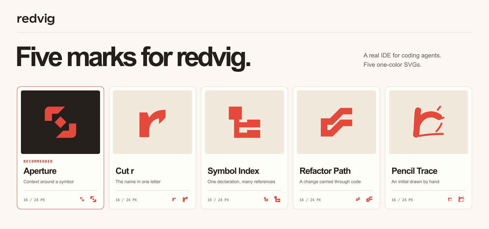

# redvig brand assets

**Aperture is the selected redvig mark.** The [homepage prototype](site/index.html) uses the production lockup and favicon. The [original logo gallery](index.html) preserves the five concepts and their 16 px and 24 px samples. Both pages open directly from disk.

| Placement | Asset |
| --- | --- |
| Website header on paper | [Color logo SVG](assets/logo-light.svg) · [PNG](assets/logo-light.png) |
| Website header on ink | [Color logo SVG](assets/logo-dark.svg) · [PNG](assets/logo-dark.png) |
| Single-color applications | [Ink logo](assets/logo-ink.svg) · [White logo](assets/logo-white.svg) |
| Standalone symbol | [Red SVG](assets/mark.svg) · [Ink SVG](assets/mark-ink.svg) · [White SVG](assets/mark-white.svg) · [Transparent PNG, 512 px](assets/mark-512.png) |
| Browser tab | [SVG](assets/mark.svg) · [ICO, 16/32/48 px](assets/favicon.ico) · [PNG, 32 px](assets/favicon-32.png) |
| iOS home screen | [Apple touch icon, 180 px](assets/apple-touch-icon.png) |
| App tile or social profile | [App icon SVG](assets/app-icon.svg) · [Avatar PNG, 512 px](assets/avatar-512.png) |
| Open Graph and social posts | [Social card PNG, 1200 × 630](assets/social-card.png) · [Editable SVG](assets/social-card.svg) |
| Sketch accents | [Rename diagram](site/rename-sketch.svg) · [Pencil underline](site/underline.svg) |

## Original concepts

| Option | Idea | Best use |
| --- | --- | --- |
| [Aperture](logos/01-aperture.svg) | Two opposing corners frame one symbol. | Primary mark. The simple silhouette carries from a browser tab to a site header. |
| [Cut r](logos/02-cut-r.svg) | A lowercase initial with an angled cut. | A compact, name-led app icon. |
| [Symbol Index](logos/03-symbol-index.svg) | A declaration anchors two indexed entries. | When the mark should evoke IDE navigation and the project model. |
| [Refactor Path](logos/04-refactor-path.svg) | One continuous path carries a change across two positions. | When the mark should emphasize editing and refactoring. |
| [Pencil Trace](logos/05-pencil-trace.svg) | A hand-drawn initial with an underline and quick pencil marks. | The most personal option, especially for docs, blog art, and other larger placements. |

## Direction

The audience starts with developers using coding agents and engineering teams evaluating agent tooling. The homepage promises access to a real IDE, then illustrates one specific task, shows how to install the current release, and links to measured experiments. This follows the core product journeys on [devrig.dev](https://devrig.dev/).

The prototype pairs the geometric Aperture mark with pencil annotations and a hand-drawn rename diagram. The warm paper, near-black sample panel, single red accent, and generous whitespace carry forward from the logo-options sheet.

| Token | Value | Use |
| --- | --- | --- |
| Paper | `#FBF8F3` | Main surface |
| Ink | `#221F1C` | Wordmark, body copy, and dark panels |
| Signal | `#E34A3C` | Marks and illustration |
| Action | `#B43229` | Links, primary buttons, and focus rings |

The site inherits devrig’s system sans-serif stack and the SF Mono–first stack used in its install examples. See the shared [typography and color tokens](identity.css). The redvig wordmark uses fixed outlines for a consistent exported shape.

## Exports

The masters are [Aperture](logos/01-aperture.svg) and the [outlined wordmark](logos/wordmark.svg). Run `node brand/build-assets.cjs` from the checkout with `sharp` available to Node to regenerate the lockups, icons, and social card. The text in the editable social SVG uses the system stack. The PNG fixes the appearance for social platforms.

The [website assets](../website/static/assets/) include the deployed logo, favicons, and [icon-only link preview](../website/static/assets/preview.png). Use the social card in this kit when you need a share image with the product name and headline.

## Prototype

The copyable examples use the current devrig installer and agent registration commands. The prototype is a local review artifact.
